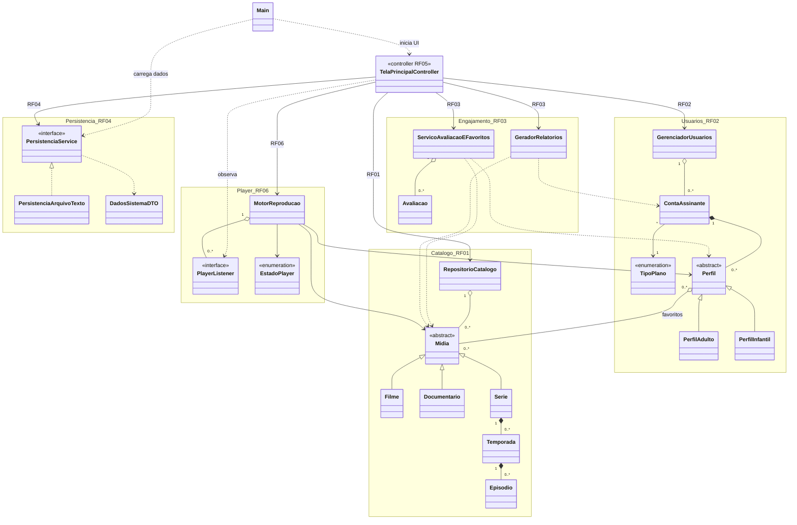
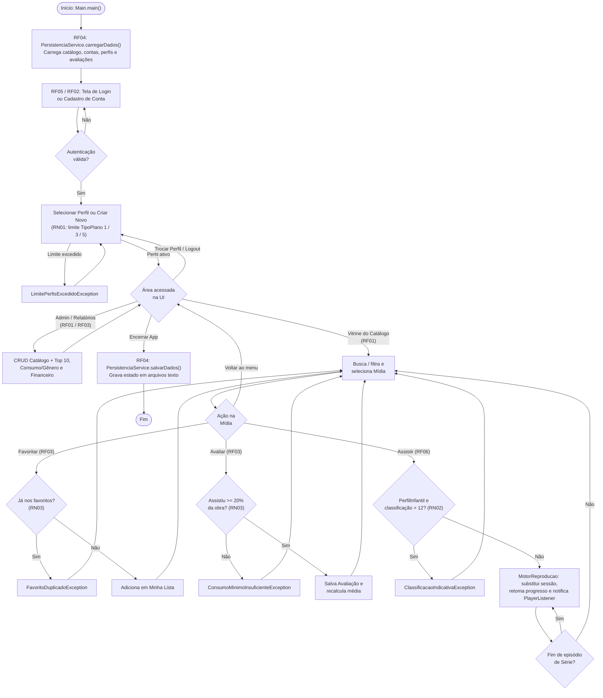

# 🎬 CineTrinta — Sistema Integrado de Streaming e Gestão de Conteúdos Audiovisuais

Repositório oficial do projeto final da disciplina de **Programação Orientada a Objetos (TI0142)** — Curso de Engenharia da Computação — **Universidade Federal do Ceará (UFC)**.  
**Professor:** Fernando Antonio Mota Trinta

---

## 👥 Equipe e Divisão de Responsabilidades

Cada integrante possui seu próprio pacote isolado com os esqueletos das classes e comentários `// TODO` indicando o que deve ser implementado, permitindo o desenvolvimento **100% independente**:

| Integrante | Matrícula | Módulo / Requisitos | Pacote Principal (`src/br/ufc/cinetrinta/...`) |
| :--- | :---: | :--- | :--- |
| **Paulo Ícaro Matias Franco** *(Líder)* | 601549 | **RF05 e RF06:** Interface Gráfica e Motor de Reprodução (Player) | `player/`, `ui/`, `main/` |
| **Davi Osugi Alencar Ferreira Gomes** | 604474 | **RF01:** Gestão do Catálogo de Conteúdos (Filmes, Séries, Episódios) | `catalogo/` |
| **João Cauã Barbosa Silva** | 598714 | **RF02:** Gestão de Assinantes, Planos (RN01) e Perfis (RN02) | `usuarios/` |
| **Gustavo Nicolas Teixeira Pinheiro** | 605004 | **RF03:** Avaliações (RN03), Favoritos, Histórico e Relatórios | `engajamento/` |
| **Samuel Lucas Oliveira Santos** | 599736 | **RF04:** Armazenamento e Carga de Dados em Arquivos (Persistência) | `persistencia/` |

---

## 📂 Estrutura de Pastas do Projeto

```text
CineTrinta/
├── docs/
│   ├── diagrama-de-classes.md  # Diagramas UML detalhados por módulo (RF01-RF06 e Exceções)
│   └── fluxogramas.md          # Fluxogramas por caso de uso e máquina de estados do Player
├── src/
│   └── br/ufc/cinetrinta/
│       ├── catalogo/        # [RF01 - Davi Osugi] Hierarquia de Mídias, Filmes, Séries e Acervo
│       ├── usuarios/        # [RF02 - João Cauã] Contas, Planos de Assinatura e Perfis (Adulto/Kids)
│       ├── engajamento/     # [RF03 - Gustavo Nicolas] Avaliações, Favoritos, Histórico e Relatórios
│       ├── persistencia/    # [RF04 - Samuel Lucas] Salvamento e Leitura de Arquivos
│       ├── player/          # [RF06 - Paulo Ícaro] Motor de Reprodução e Controle de Estados
│       ├── ui/              # [RF05 - Paulo Ícaro] Telas da Interface Gráfica
│       ├── exceptions/      # Exceções Customizadas das Regras de Negócio (RN01, RN02, RN03)
│       └── main/            # Classe Principal de Inicialização (Main.java)
└── README.md
```

---

## ⚖️ Regras de Negócio e Exceções Customizadas

* **RN01 (Limite de Perfis por Plano de Assinatura):**
  * **Plano Básico:** até 1 perfil | **Plano Padrão:** até 3 perfis | **Plano Premium:** até 5 perfis.
  * Exceção lançada: `LimitePerfisExcedidoException` (pacote `exceptions`).
* **RN02 (Bloqueio Parental por Classificação Indicativa):**
  * Perfis na modalidade **Infantil (Kids)** são impedidos de acessar ou reproduzir títulos com classificação superior a **12 anos**.
  * Exceção lançada: `ClassificacaoIndicativaException` (pacote `exceptions`).
* **RN03 (Consumo Mínimo para Avaliação e Unicidade de Favoritos):**
  * Um perfil só pode avaliar uma obra (1 a 5 estrelas) se tiver assistido a pelo menos **20%** da duração total.
  * Um título não pode ser inserido em duplicidade na lista de favoritos do mesmo perfil.
  * Exceções lançadas: `ConsumoMinimoInsuficienteException` e `FavoritoDuplicadoException` (pacote `exceptions`).

---

## 🏗️ Arquitetura, Diagrama de Classes e Fluxograma

* 🧱 **[Diagramas de Classes UML Detalhados (`docs/diagrama-de-classes.md`)](docs/diagrama-de-classes.md)** — Visão modular completa de todos os 8 pacotes (`RF01`–`RF06` e `exceptions`).
* 🔀 **[Fluxogramas Detalhados e Máquina de Estados (`docs/fluxogramas.md`)](docs/fluxogramas.md)** — Fluxos passo a passo de Persistência, Login/`RN01`, Catálogo/`RN02`/Player (`EstadoPlayer`) e Engajamento/`RN03`.

### 🧱 Diagrama de Classes — Visão Geral da Arquitetura



> 👉 Veja os atributos, métodos, `Genero`, `ClassificacaoIndicativa` e a hierarquia completa das 4 exceções customizadas em **[`docs/diagrama-de-classes.md`](docs/diagrama-de-classes.md)**.

### 🔀 Fluxograma Geral do Sistema



> 👉 Veja os fluxogramas separados por módulo e a **Máquina de Estados (`EstadoPlayer`)** em **[`docs/fluxogramas.md`](docs/fluxogramas.md)**.

---

## 🚀 Como Trabalhar no Seu Módulo (Fluxo Git Recomendado)

1. **Clonar o repositório:**
   ```bash
   git clone https://github.com/icaro-arch/CineTrinta.git
   cd CineTrinta
   ```
2. **Criar uma branch para o seu módulo (opcional, mas recomendado):**
   ```bash
   git checkout -b feature/rf01-catalogo
   ```
3. **Abrir a pasta do seu pacote:**
   * Leia os comentários `// TODO:` dentro dos arquivos `.java` do seu pacote.
   * Implemente os atributos, construtores, getters/setters e a lógica dos métodos indicados.
4. **Enviar suas alterações:**
   ```bash
   git add .
   git commit -m "feat: implementa classes do modulo RF01"
   git push origin main
   ```
