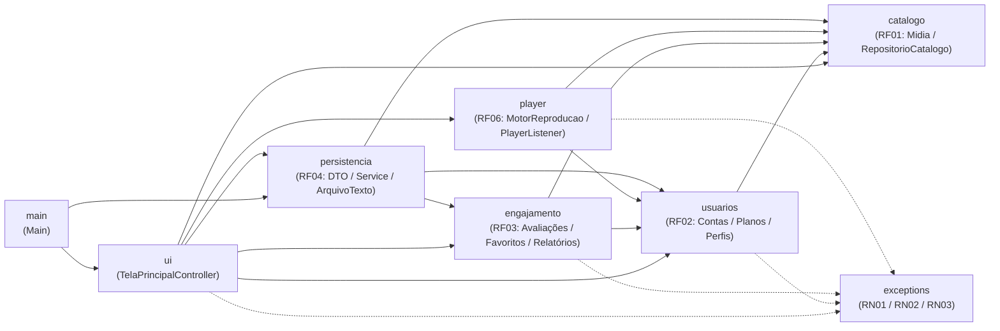
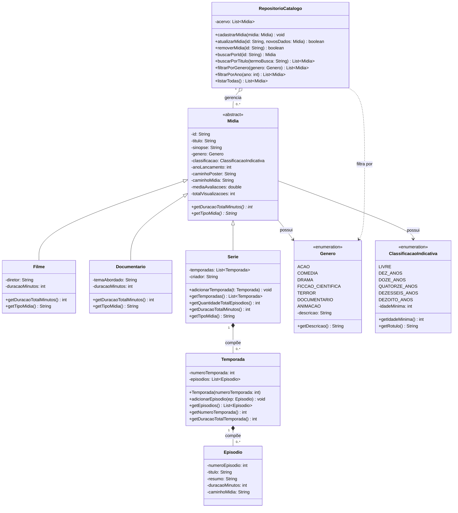
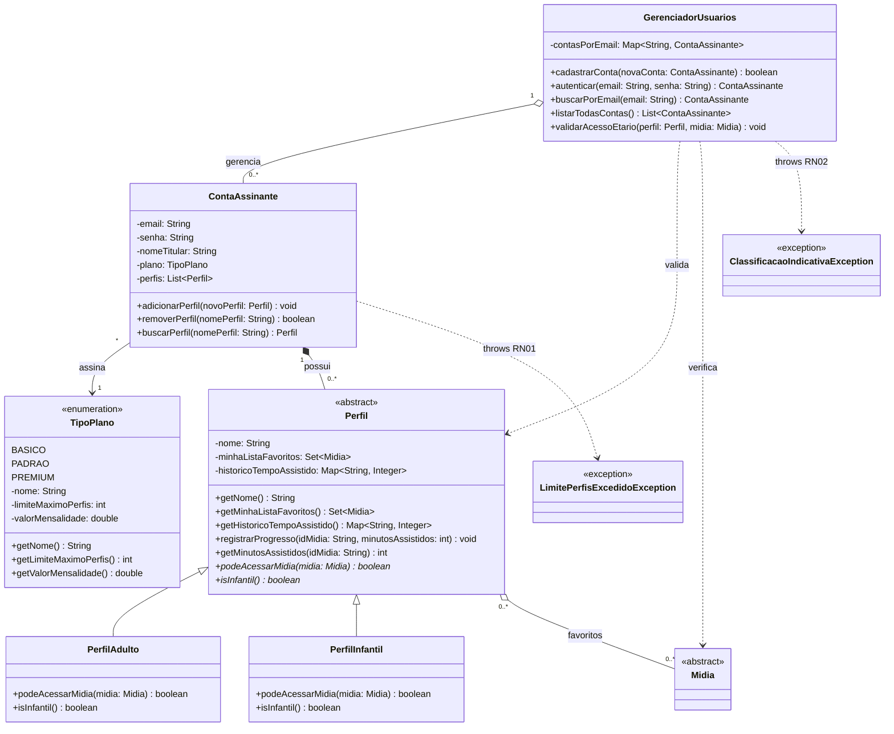
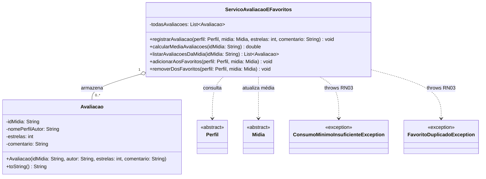
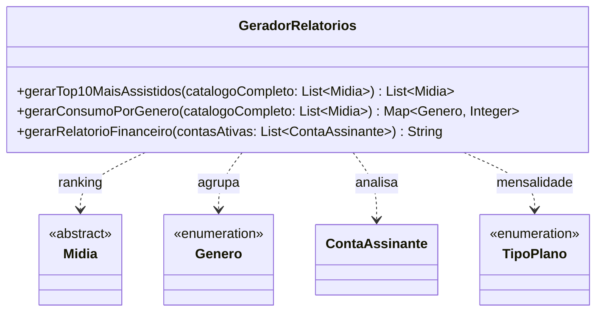
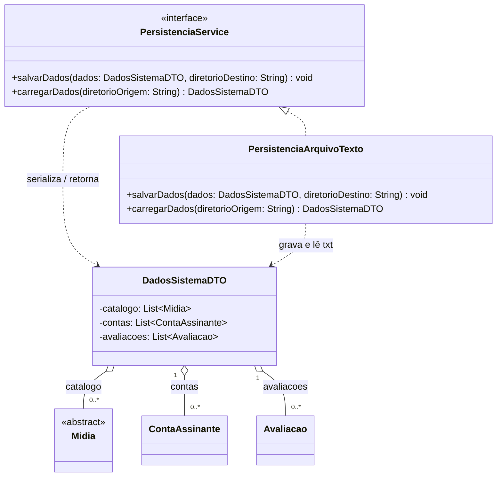
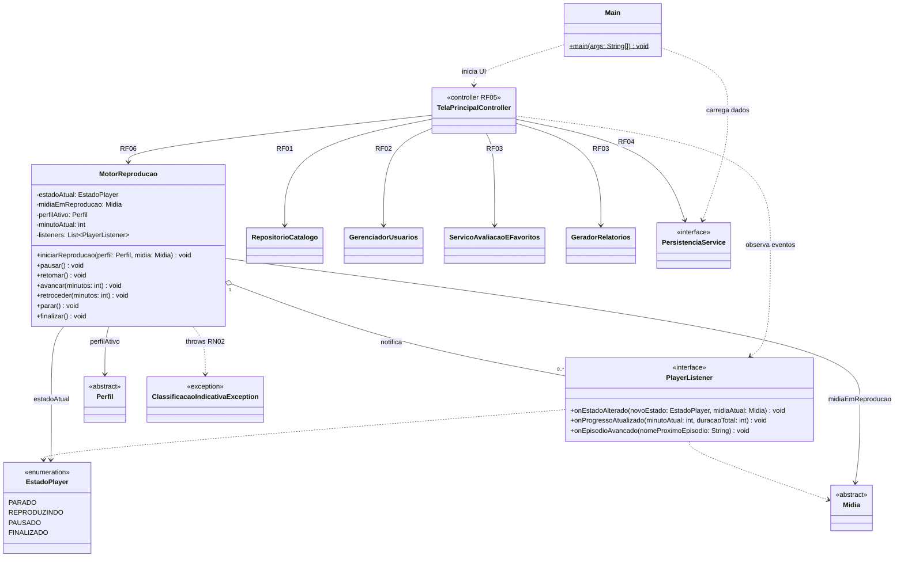
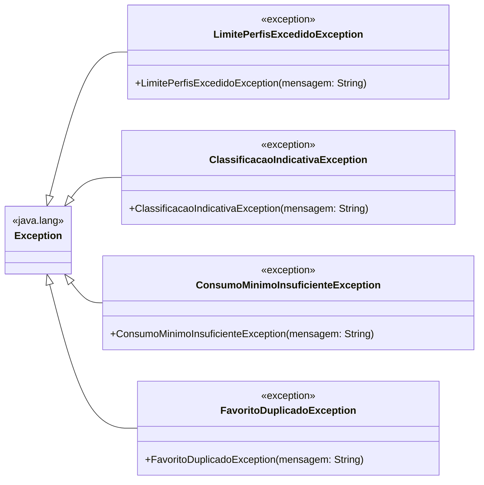

# 🧱 Diagramas de Classes UML — CineTrinta

> ⬅️ [Voltar para o README principal](../README.md) · 🔀 [Ver Fluxogramas Detalhados](fluxogramas.md)

Este documento reúne o **Diagrama de Classes UML completo** do projeto **CineTrinta**, separado por módulos (`RF01` a `RF06` e `exceptions`) para manter a leitura clara e legível tanto no GitHub quanto no VS Code.

> **Nota sobre o estado atual do código:** O repositório encontra-se na fase de arquitetura inicial (esqueletos das classes). Os diagramas refletem fielmente **as classes, interfaces, enumerações, exceções e assinaturas já declaradas** no código-fonte, bem como os **atributos, construtores e métodos planejados nos comentários `// TODO:`** de cada arquivo (destacados nas observações abaixo de cada módulo).

### Legenda UML (Mermaid)

| Símbolo / Seta | Significado | Exemplo |
| :--- | :--- | :--- |
| `<\|--` | Herança (`extends`) | `Midia <\|-- Filme` |
| `<\|..` | Implementação de Interface (`implements`) | `PersistenciaService <\|.. PersistenciaArquivoTexto` |
| `*--` | Composição (ciclo de vida dependente) | `Serie *-- Temporada` |
| `o--` | Agregação (coleção / referência gerenciada) | `RepositorioCatalogo o-- Midia` |
| `-->` | Associação direta (atributo de instância) | `ContaAssinante --> TipoPlano` |
| `..>` | Dependência (parâmetro, retorno ou `throws`) | `ContaAssinante ..> LimitePerfisExcedidoException` |
| `~T~` | Tipo genérico (`<T>`) | `List~Midia~`, `Map~String, Integer~` |
| `*` (ao final do método) | Método abstrato (`abstract`) | `+getDuracaoTotalMinutos()* int` |

---

## 1. Arquitetura Modular e Dependências entre Pacotes

Visão macro de como o ponto de entrada (`main`) e a camada de interface (`ui`) orquestram os módulos de domínio, serviços, persistência e o tratamento de exceções:

---

## 2. Módulo Catálogo (`br.ufc.cinetrinta.catalogo` — RF01)

Responsável pela hierarquia polimórfica de mídias (`Midia`), estrutura hierárquica de séries (`Serie` → `Temporada` → `Episodio`) e operações de CRUD/busca no acervo (`RepositorioCatalogo`).

> **Observações (`// TODO`):**
> * Construtores, getters e setters de `Midia`, `Filme`, `Documentario`, `Serie` e `Episodio` foram omitidos nas caixas para preservar a legibilidade.
> * Em `ClassificacaoIndicativa`, `getIdadeMinima()` já está implementado; `getRotulo()` e os campos de `Genero` (`descricao`, `getDescricao()`) são planejados via `// TODO`.

---

## 3. Módulo Usuários, Planos e Perfis (`br.ufc.cinetrinta.usuarios` — RF02)

Controla o cadastro/autenticação de contas (`GerenciadorUsuarios`), cotas de perfis por plano (`RN01` em `ContaAssinante` e `TipoPlano`) e validação polimórfica de faixa etária (`RN02` em `PerfilAdulto` e `PerfilInfantil`).

> **Observações (`// TODO`):**
> * Construtores, getters e setters de `ContaAssinante`, `PerfilAdulto` e `PerfilInfantil` foram omitidos nas caixas para manter o diagrama compacto.
> * Em `ContaAssinante`, `adicionarPerfil(...)` já possui assinatura declarada; os métodos de remoção/busca de perfil (`removerPerfil`, `buscarPerfil`) estão previstos no `// TODO #4` do arquivo.

---

## 4. Módulo Engajamento e Relatórios (`br.ufc.cinetrinta.engajamento` — RF03)

Gerencia notas/resenhas (`Avaliacao`), validação de consumo mínimo de 20% e unicidade de favoritos (`RN03` em `ServicoAvaliacaoEFavoritos`), além dos relatórios gerenciais (`GeradorRelatorios`).

### 4.1 Avaliações e Favoritos (`ServicoAvaliacaoEFavoritos` e `Avaliacao`)

### 4.2 Relatórios Gerenciais (`GeradorRelatorios`)

> **Observação (`// TODO`):** Em `Avaliacao`, o construtor (com validação de `1..5` estrelas), getters e setters estão especificados nos comentários `// TODO`.

---

## 5. Módulo Persistência (`br.ufc.cinetrinta.persistencia` — RF04)

Desacopla o sistema do formato de armazenamento através da interface `PersistenciaService` e do objeto agregador `DadosSistemaDTO`.

> **Observações (`// TODO`):**
> * `DadosSistemaDTO` prevê construtor, getters e setters para `catalogo`, `contas` e `avaliacoes`.
> * Arquivos previstos em `PersistenciaArquivoTexto`: `catalogo.txt`, `contas_perfis.txt` e `avaliacoes.txt` (delimitados por `;` com `BufferedWriter`/`BufferedReader`).

---

## 6. Módulos Player, Interface Gráfica e Inicialização (`player`, `ui`, `main` — RF05 & RF06)

Integra o ponto de entrada (`Main`), o controlador de telas (`TelaPrincipalController`) e o motor de reprodução com padrão **Observer** (`MotorReproducao` + `PlayerListener` + `EstadoPlayer`).

> **Observações (`// TODO`):**
> * Em `MotorReproducao`, os métodos `iniciarReproducao`, `pausar`, `avancar`, `retroceder` e `parar` já possuem assinaturas declaradas; `retomar()` e `finalizar()` estão especificados no bloco `// TODO` da classe (assim como o gerenciamento da lista `listeners`).
> * `TelaPrincipalController` prevê as conexões acima com todos os serviços do sistema e a atuação como observador (`PlayerListener`) das mudanças do player.

---

## 7. Hierarquia de Exceções (`br.ufc.cinetrinta.exceptions`)

Todas as exceções de negócio são **checked exceptions** (estendem `java.lang.Exception`), exigindo tratamento explícito pelas camadas chamadoras e pela interface gráfica.

| Exceção | Regra | Disparo previsto em | Motivo |
| :--- | :---: | :--- | :--- |
| `LimitePerfisExcedidoException` | **RN01** | `ContaAssinante.adicionarPerfil(...)` | Quantidade de perfis atingiu `plano.getLimiteMaximoPerfis()` (`1`, `3` ou `5`). |
| `ClassificacaoIndicativaException` | **RN02** | `GerenciadorUsuarios.validarAcessoEtario(...)` / `MotorReproducao.iniciarReproducao(...)` | `PerfilInfantil` tentando acessar ou reproduzir mídia com `idadeMinima > 12`. |
| `ConsumoMinimoInsuficienteException` | **RN03** | `ServicoAvaliacaoEFavoritos.registrarAvaliacao(...)` | Perfil assistiu a menos de **20%** de `midia.getDuracaoTotalMinutos()`. |
| `FavoritoDuplicadoException` | **RN03** | `ServicoAvaliacaoEFavoritos.adicionarAosFavoritos(...)` | Mídia já presente em `perfil.getMinhaListaFavoritos()`. |
