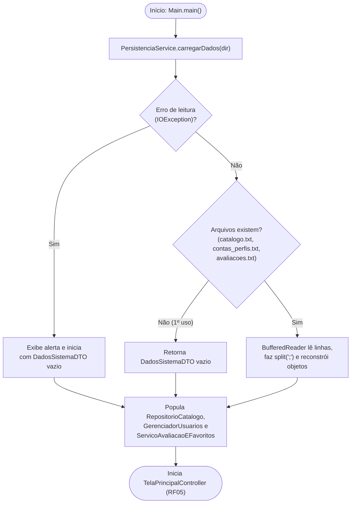
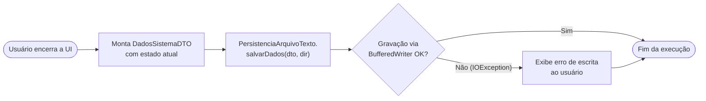
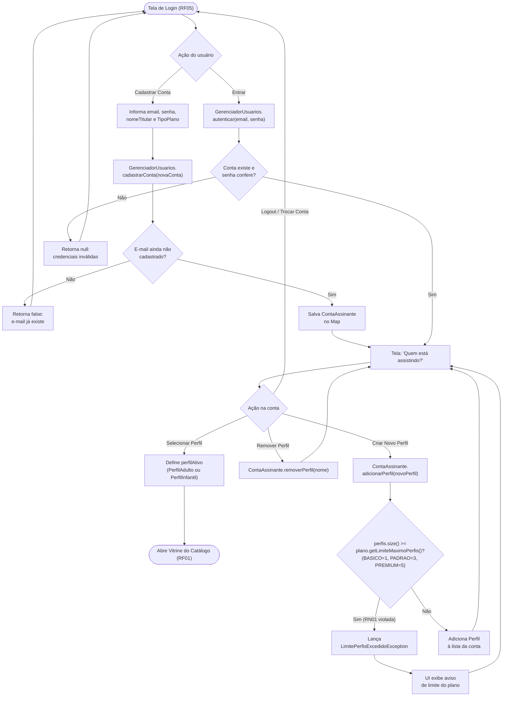
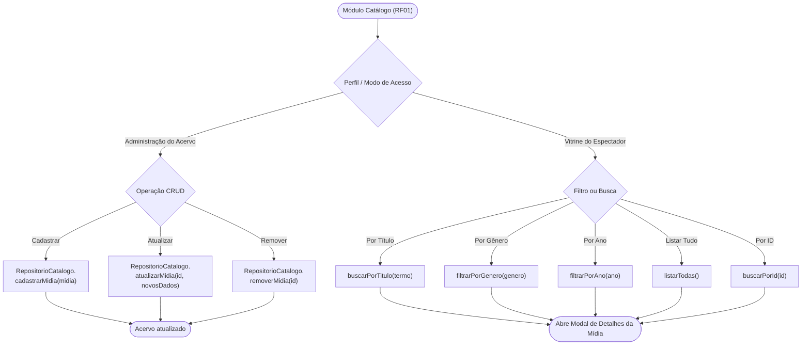
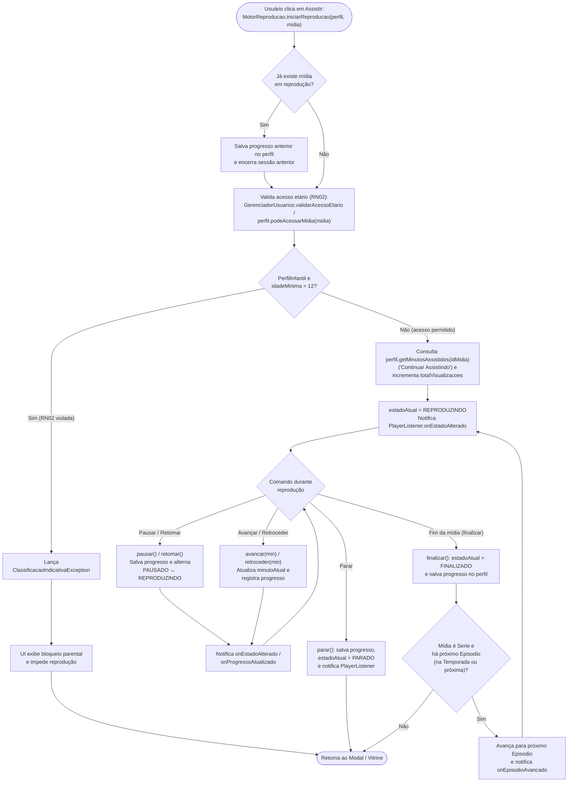
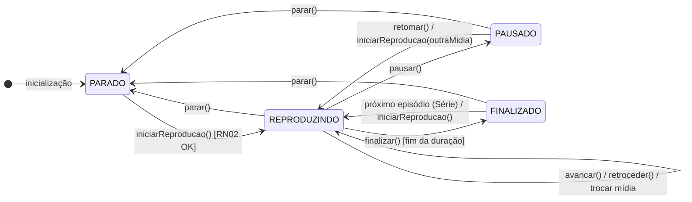
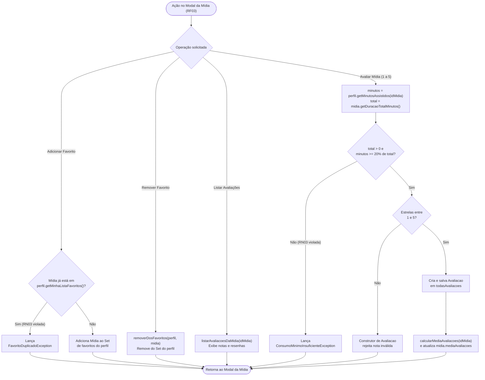
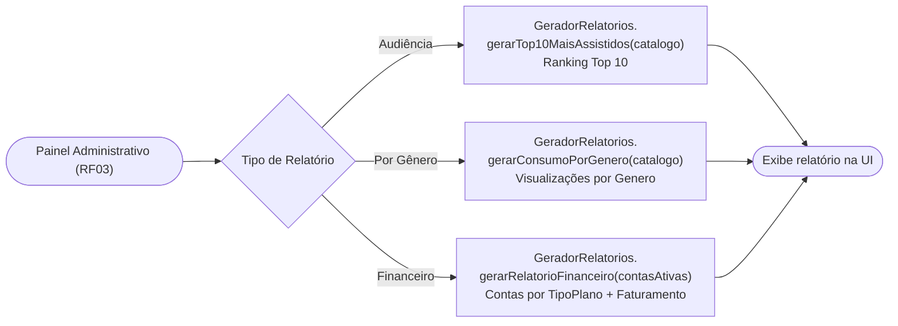

# 🔀 Fluxogramas e Máquina de Estados — CineTrinta

> ⬅️ [Voltar para o README principal](../README.md) · 🧱 [Ver Diagramas de Classes UML](diagrama-de-classes.md)

Este documento detalha os fluxos operacionais do **CineTrinta** por caso de uso e requisito funcional (`RF01`–`RF06`), incluindo as validações obrigatórias das regras de negócio (**RN01**, **RN02** e **RN03**) e a máquina de estados do player.

---

## 1. Inicialização e Persistência em Arquivos (`RF04`)

Fluxo executado por `Main.main(...)` e `PersistenciaArquivoTexto` na abertura e no encerramento da aplicação.

### 1.1 Carga Inicial (Startup)

### 1.2 Salvamento (Encerramento)

---

## 2. Autenticação, Planos e Gestão de Perfis (`RF02` e `RN01`)

Fluxo de entrada do assinante, criação de conta, seleção/remoção de perfil e validação da cota máxima de perfis por plano (**RN01**).

---

## 3. Catálogo (`RF01`), Bloqueio Parental (`RN02`) e Player (`RF06`)

### 3.1 Gestão Administrativa e Consultas ao Catálogo (`RF01`)

### 3.2 Bloqueio Parental (`RN02`) e Fluxo do Player Integrado (`RF06`)

---

## 4. Máquina de Estados do Player (`EstadoPlayer` — RF06)

Transições válidas controladas por `MotorReproducao` e comunicadas à interface gráfica via `PlayerListener`.

> *Nota:* Em `pausar()`, `parar()`, `avancar()`, `retroceder()`, `finalizar()` e troca de mídia (`iniciarReproducao` com sessão ativa), o `MotorReproducao` persiste `minutoAtual` em `perfil.registrarProgresso(idMidia, minutoAtual)` antes de concluir a transição.

---

## 5. Engajamento (`RN03`) e Relatórios Gerenciais (`RF03`)

### 5.1 Favoritos e Avaliações (`ServicoAvaliacaoEFavoritos`)

### 5.2 Relatórios Gerenciais (`GeradorRelatorios`)

